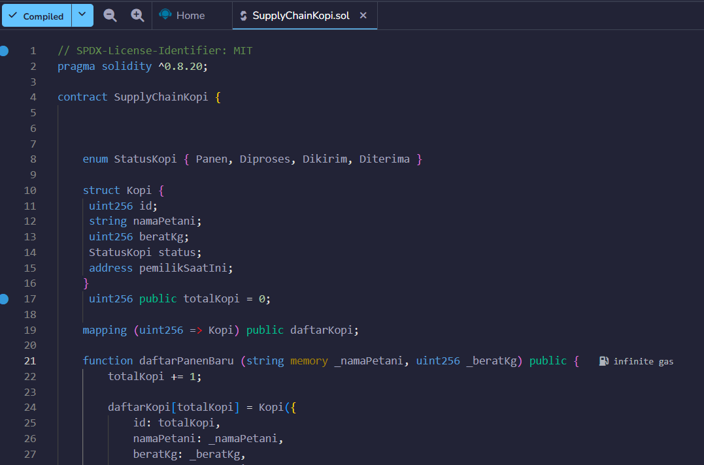
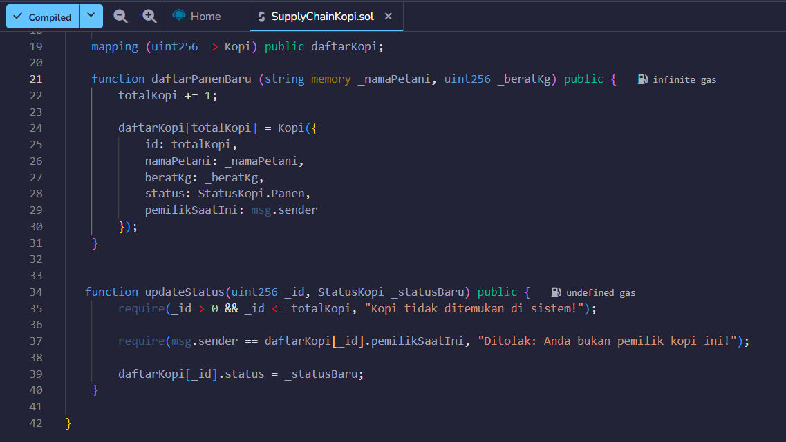
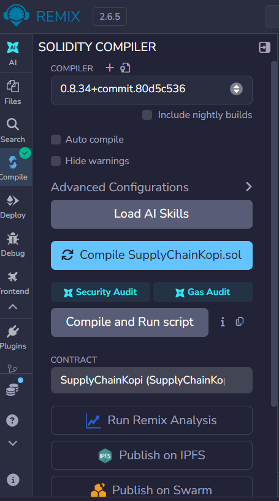
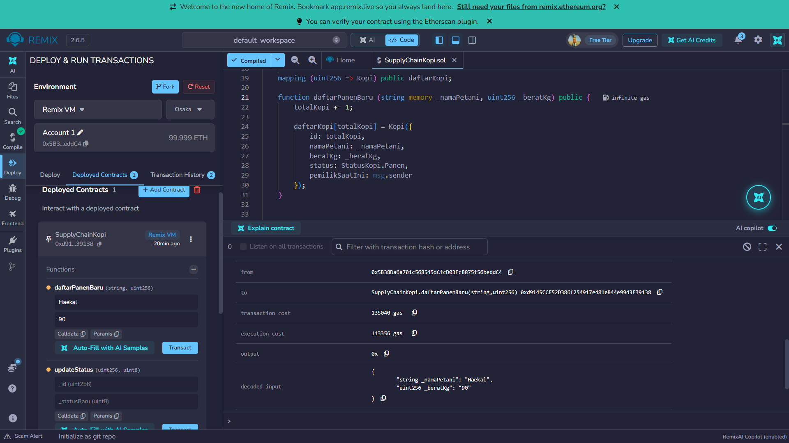
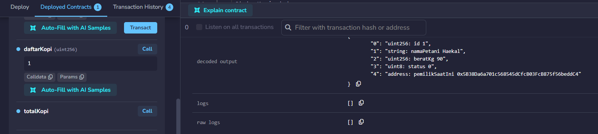

# Praktikum 6: Membuat Smart Contract dengan Solidity di Remix #

## Tujuan Pembelajaran
Setelah menyelesaikan praktikum ini, mahasiswa diharapkan mampu:
1. Memahami konsep dasar dari smart contract pada Blockchain.
2. Menggunakan platform Remix untuk menulis, mengompilasi, dan men-deploy smart contract berbasis Solidity.
3. Mengimplementasikan fungsionalitas dasar smart contract yang melibatkan state variable dan fungsi.
4. Melakukan interaksi dengan smart contract yang sudah ter-deploy melalui Remix.

### Proses Praktikum ###

1. Buka [Remmix IDE](https://remix.ethereum.org/) login via Gmail, bukti:
.png>)

2. Buat file baru di files dengan nama file (SupplyChainKopi.sol) Isi coding sesuai dengan modul.

3. Compile Smart Contract

4. Deploy & Testing Smart Contract

-Deploy Smart Contract + Menambahkan Data Panen Baru (daftarPanenBaru)

-B. Memanggil Data Panen (daftarKopi)
