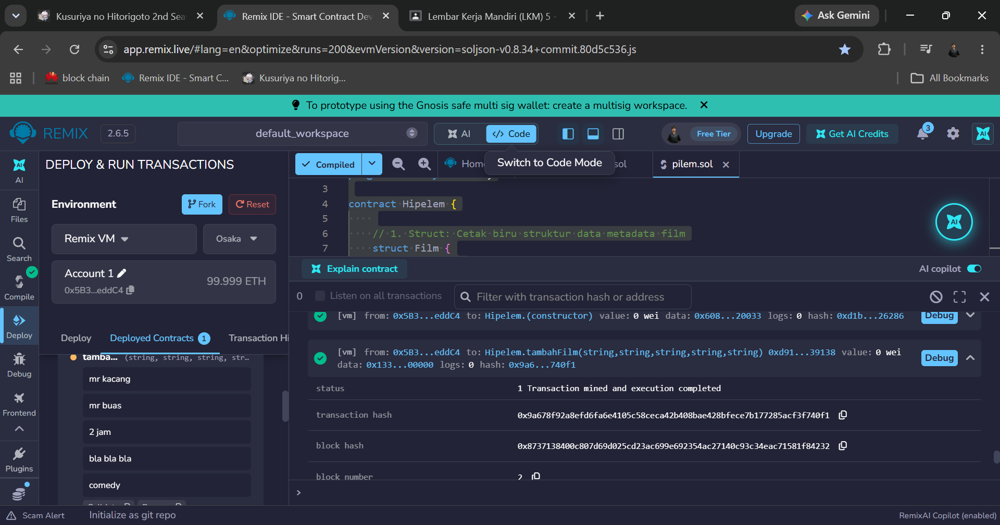
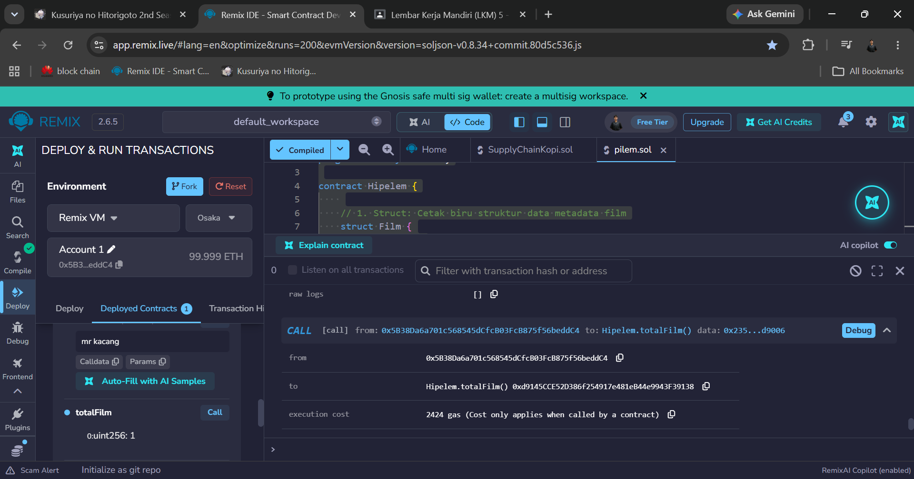

# LAPORAN PROGRES MINGGUAN: PRAKTIKUM SMART CONTRACT & SOLIDITY

**Nama Proyek Kelompok:**
1. fakhri muhtasib
2. muhammad haekal bilal
3. putra rais hakim
---

---

---
## A. Pendahuluan & Latar Belakang

Hipelem merupakan platform pengelolaan metadata film berbasis teknologi blockchain. Pada praktikum kali ini, dilakukan perancangan dan implementasi awal *Smart Contract* menggunakan bahasa pemrograman Solidity pada lingkungan Remix IDE. Smart Contract ini berfungsi sebagai pilar utama penyimpanan data metadata film yang tersentralisasi pada rantai blok (*blockchain*), menggantikan atau melengkapi struktur transaksi lokal Python sebelumnya agar tercipta integritas, keandalan, dan transparansi data.

---

## B. Desain Arsitektur Sistem 

### 1. Struktur Data (`Struct Film`)
Struktur data dirancang untuk merekam informasi penting dari setiap entri film yang diinputkan pengguna. Atribut yang disimpan meliputi:

* `id` (`uint256`): Pengenal unik berbasis angka increment untuk tiap film.
* `namaFilm` (`string`): Judul film.
* `sutradara` (`string`): Nama sutradara pengarah film.
* `durasi` (`string`): Durasi penayangan film (misal: "2 jam").
* `sinopsis` (`string`): Ringkasan atau gambaran umum cerita film.
* `genre` (`string`): Kategori genre film (Action, Comedy, Drama, Horror, Romance, Sci-Fi, Thriller, Documentary).
* `pemilik` (`address`): Alamat dompet digital (*wallet address*) dari pengunggah/pemilik data film tersebut.

### 2. Pemetaan & State Variables (`Mapping`)
Untuk menyimpan dan mengakses data pada ledger blockchain, digunakan variabel berikut:

* `uint256 public totalFilm`: State variable untuk menghitung jumlah total film yang tersimpan di dalam contract.
* `mapping(uint256 => Film) public daftarFilm`: Struktur key-value pasang angka ID ke Struct `Film`, mempermudah pencarian data berdasarkan ID.

### 3. Bagan Alir Data (Flowchart)

```text
+-------------------------------------------------------------+
|                     Pengguna / Admin                        |
+-------------------------------------------------------------+
                              |
                              | Memanggil fungsi tambahFilm()
                              v
+-------------------------------------------------------------+
|                     Smart Contract                          |
|  - Input: namaFilm, sutradara, durasi, sinopsis, genre      |
+-------------------------------------------------------------+
                              |
                              | 1. Increment totalFilm (totalFilm += 1)
                              | 2. Capture msg.sender (Alamat Wallet)
                              v
+-------------------------------------------------------------+
|                Penyimpanan Data (Mapping)                  |
|  daftarFilm[totalFilm] = Film(id, nama, sutradara, ...)    |
+-------------------------------------------------------------+
                              |
                              v
+-------------------------------------------------------------+
|               State Berhasil Disimpan (EVM)                 |
+-------------------------------------------------------------+
```

---

## C. Drafting Smart Contract Solidity (Tugas Kelompok 2)

Berikut adalah kode *Smart Contract* `Hipelem.sol` yang telah berhasil diuji dan di-compile tanpa kesalahan (centang hijau) pada compiler `0.8.20`.

```solidity
// SPDX-License-Identifier: MIT
pragma solidity ^0.8.20;

/// @title Smart Contract Metadata Film Hipelem
/// @notice Digunakan untuk merekam dan mengelola metadata film ke dalam blockchain
contract Hipelem {

    // 1. Struct: Cetak biru penyimpanan data film
    struct Film {
        uint256 id;
        string namaFilm;
        string sutradara;
        string durasi;
        string sinopsis;
        string genre;
        address pemilik;
    }

    // 2. State Variables
    uint256 public totalFilm = 0;

    // 3. Mapping: Mencari data Film berdasarkan ID
    mapping(uint256 => Film) public daftarFilm;

    // 4. Fungsi Tambah Data (Create)
    function tambahFilm(
        string memory _namaFilm,
        string memory _sutradara,
        string memory _durasi,
        string memory _sinopsis,
        string memory _genre
    ) public {
        // Increment total film
        totalFilm += 1;

        // Memasukkan data ke dalam mapping
        daftarFilm[totalFilm] = Film({
            id: totalFilm,
            namaFilm: _namaFilm,
            sutradara: _sutradara,
            durasi: _durasi,
            sinopsis: _sinopsis,
            genre: _genre,
            pemilik: msg.sender
        });
    }
}
```

---

## D. Hasil Pengujian di Remix IDE

1. **Kompilasi (Compile)**:
   * **Compiler Version**: `0.8.20`
   * **Status**: Successful (Centang hijau di Remix IDE).
2. **Deploy & Run Transactions**:
   * **Environment**: Remix VM (Cancun)
   * **Eksekusi Fungsi**: Memanggil fungsi `tambahFilm()` dengan contoh parameter input:
     * `_namaFilm`: `"Inception"`
     * `_sutradara`: `"Christopher Nolan"`
     * `_durasi`: `"2.5 jam"`
     * `_sinopsis`: `"Pencurian ide melalui alam mimpi."`
     * `_genre`: `"Sci-Fi"`
   * **Verifikasi Data**: Memanggil variabel `daftarFilm(1)` menghasilkan kembalian data struct lengkap beserta alamat `pemilik` yang sesuai dengan `msg.sender` akun Remix VM.

---

## E. Kesimpulan & Langkah Selanjutnya

Praktikum berhasil mengimplementasikan struktur dasar Smart Contract Solidity untuk platform **Hipelem**. Sistem dapat menerima data metadata film baru dan menyimpannya secara transparan pada ledger blockchain lokal. 

**Langkah Selanjutnya:**
* Menambahkan fungsi kontrol akses (misal: modifier `onlyOwner` atau `require`).
* Mengintegrasikan interface Streamlit (`app.py`) dengan Smart Contract menggunakan pustaka Web3.py.